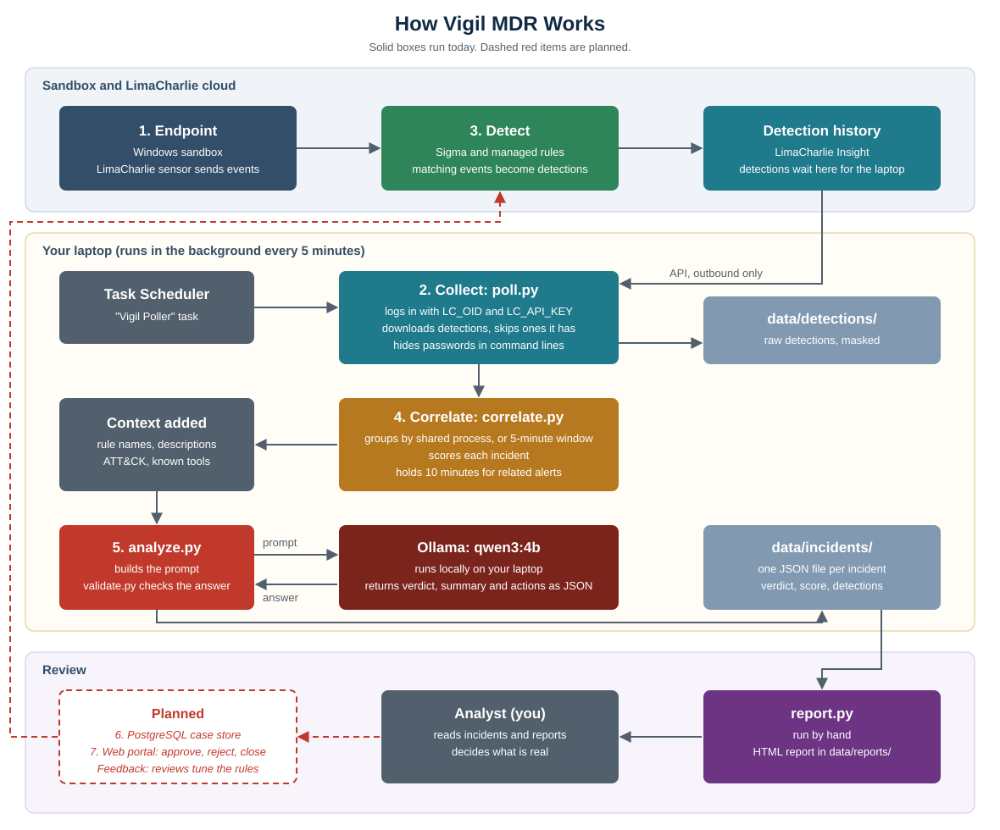

# Vigil MDR

Vigil is a personal Managed Detection and Response (MDR) lab project. It collects LimaCharlie detections from a Windows sandbox, groups related alerts into scored incidents, and uses a local AI model to suggest a verdict for a human analyst to review.

It's a learning project, not a production security service. It doesn't block attacks, and its AI verdicts haven't been measured for accuracy yet.

## What works today

- Pulls new LimaCharlie detections every 5 minutes through a Windows scheduled task.
- Masks passwords and tokens found in command lines before saving detections.
- Groups detections into incidents by shared process and time window.
- Scores incidents using rule severity, ATT&CK techniques and access to LSASS.
- Sends each incident to a local Ollama model, so detection data stays on the laptop.
- Validates the model's JSON and rejects evidence IDs it makes up.
- Stores incidents, detections, events and verdicts in PostgreSQL.
- Builds HTML and PDF reports with indicators, command lines, hashes and a timeline.
- Provides a local web portal to review incidents, view process trees, and approve, reject or close incidents.

## Project status

| Stage | Status |
|---|---|
| 1. Endpoints | Done |
| 2. Collect | Done |
| 3. Detect | Working, needs tuning |
| 4. Correlate | Working, needs tuning |
| 5. AI Analyze | Running, accuracy not measured |
| 6. Case Store | Done |
| 7. Web Portal | Done |
| Analyst review | Done |
| Feedback loop | Planned |

The detailed task list is in [SPRINT_STATUS.md](SPRINT_STATUS.md).

## Tech stack

- **Detection:** LimaCharlie, with Sigma and managed rules
- **Pipeline:** Python and Windows Task Scheduler
- **AI:** Ollama with the `qwen3:4b` model
- **Storage:** PostgreSQL 17
- **Portal:** FastAPI, Jinja and HTMX

## Project layout

| Path | Purpose |
|---|---|
| `poll.py` | Runs the pipeline: fetch, mask, correlate and analyze |
| `correlate.py` | Groups detections and scores incidents |
| `analyze.py` | Sends incidents to Ollama |
| `validate.py` | Checks the model's answers |
| `db.py` | Reads and writes PostgreSQL |
| `schema.sql` | Database tables |
| `report.py` | Builds the HTML report |
| `portal.py` | Runs the web portal |
| `process_tree.py` | Builds incident process trees |
| `templates/`, `static/` | Portal pages and styling |
| `adapters/` | Converts LimaCharlie detections into a simple format |
| `prompts/` | Instructions for the AI model |
| `schema/` | Required format for AI verdicts |
| `tools/` | Daily status script |
| `docs/` | Architecture diagram |

## Getting started

Setup, daily use, settings and troubleshooting are all in [instructions.md](instructions.md). The full design is in the [implementation guide (PDF)](docs/Vigil-MDR-Implementation.pdf).

## Data and secrets

Detection data stays in `data/`, which Git ignores, and in a local PostgreSQL database that accepts connections from the laptop only. The portal requires a password, and can be published over HTTPS through a Cloudflare tunnel. LimaCharlie and database credentials are stored in Windows user environment variables and never in the code.
