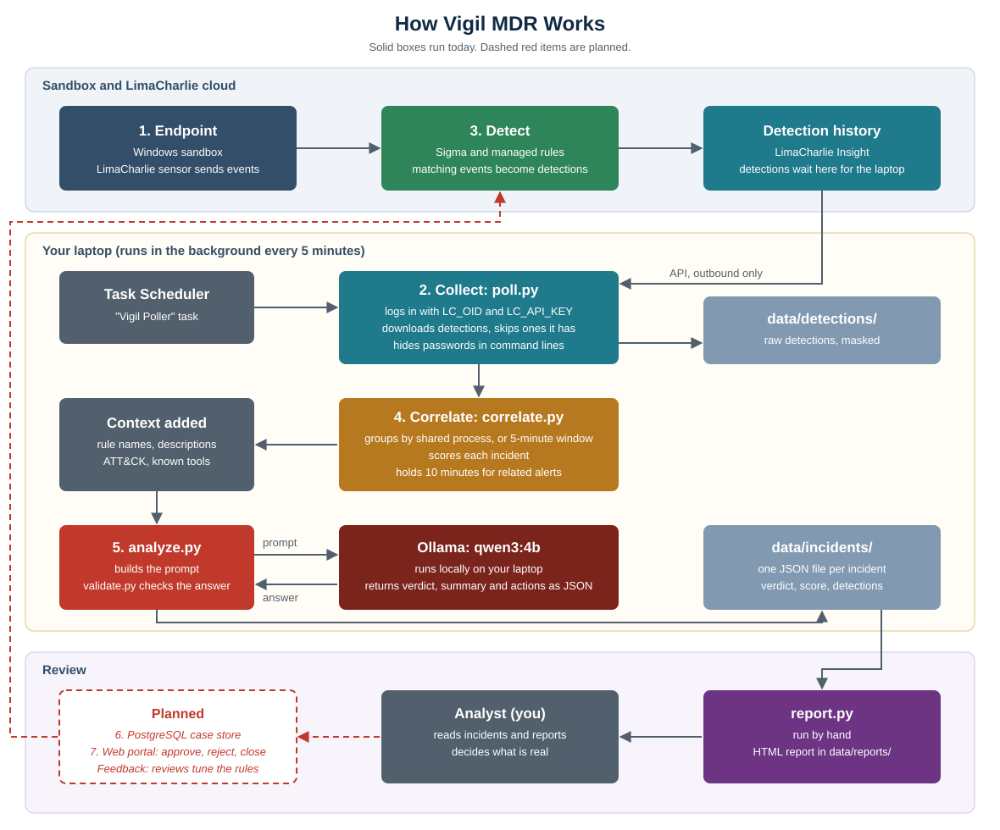

# Vigil MDR Instructions

Vigil downloads detections from LimaCharlie, groups related ones into incidents, and asks a local Ollama model for a verdict. It runs in the background every 5 minutes on a Windows laptop.

Vigil only assists a human reviewer. It doesn't block attacks, and its verdicts need checking.



## What you need

- Windows with PowerShell
- Python 3
- [Ollama](https://ollama.com) with the `qwen3:4b` model
- PostgreSQL 17 with a `vigil` database and login
- A LimaCharlie organization with Insight enabled
- A LimaCharlie API key with only the `insight.det.get` permission

## First-time setup

1. Open PowerShell in this folder, then create the Python environment:

   ```powershell
   python -m venv .venv
   .\.venv\Scripts\Activate.ps1
   pip install -r requirements.txt
   ```

2. Get the model and confirm it's listed:

   ```powershell
   ollama pull qwen3:4b
   ollama list
   ```

3. Save your LimaCharlie details as Windows user variables. Never put them in code:

   ```powershell
   [Environment]::SetEnvironmentVariable("LC_OID", "your-org-id", "User")
   [Environment]::SetEnvironmentVariable("LC_API_KEY", "your-api-key", "User")
   [Environment]::SetEnvironmentVariable("VIGIL_DB_PASSWORD", "your-db-password", "User")
   ```

4. Close PowerShell and open it again in this folder. Create the database tables, then test once:

   ```powershell
   .\.venv\Scripts\Activate.ps1
   python db.py
   python poll.py
   Get-Content data\poll.log -Tail 10
   ```

   The first run looks back 3 days and can take several minutes.

## Turn on the background job

Run this in this folder. It runs `poll.py` every 5 minutes with no window:

```powershell
$dir = (Get-Location).Path
$action = New-ScheduledTaskAction -Execute "$dir\.venv\Scripts\pythonw.exe" -Argument "`"$dir\poll.py`"" -WorkingDirectory $dir
$trigger = New-ScheduledTaskTrigger -Once -At (Get-Date).AddMinutes(1) -RepetitionInterval (New-TimeSpan -Minutes 5) -RepetitionDuration (New-TimeSpan -Days 3650)
$settings = New-ScheduledTaskSettingsSet -StartWhenAvailable -AllowStartIfOnBatteries -DontStopIfGoingOnBatteries -MultipleInstances IgnoreNew -ExecutionTimeLimit (New-TimeSpan -Hours 1)
Register-ScheduledTask -TaskName 'Vigil Poller' -Action $action -Trigger $trigger -Settings $settings
```

It runs only while you're logged in, and Ollama and PostgreSQL must be running.

On this laptop, PostgreSQL 17 is installed in `F:\PostgreSQL`, accepts connections from this machine only, and starts at login through the "Vigil PostgreSQL" scheduled task.

## Daily use

There's nothing to start. Check results whenever you like:

| To see | Open |
|---|---|
| Incidents and verdicts | PostgreSQL `vigil` database, or a generated report |
| What the job has been doing | `data\poll.log` |
| Raw detections, with passwords hidden | `data\detections\` |

To build a full report with indicators and a timeline, run:

```powershell
.\.venv\Scripts\python.exe report.py
```

It's saved in `data\reports\`. Open the newest `.html` file in a browser.

To see incidents directly in the database, run:

```powershell
$env:PGPASSWORD = [Environment]::GetEnvironmentVariable('VIGIL_DB_PASSWORD','User')
F:\PostgreSQL\env\Library\bin\psql.exe -h localhost -U vigil -d vigil -c "SELECT i.incident_id, i.score, a.verdict, a.confidence FROM incidents i LEFT JOIN analyses a USING (incident_id) ORDER BY i.score DESC, a.created_at DESC"
Remove-Item Env:PGPASSWORD
```

| Table | Holds |
|---|---|
| `incidents` | One row per incident, with score and grouping details |
| `detections` | Each LimaCharlie detection, masked, linked to its incident |
| `events` | Process events used as evidence |
| `analyses` | Ollama's verdicts, including older ones when an incident is re-analyzed |

## Control the job

```powershell
Get-ScheduledTask -TaskName 'Vigil Poller'       # check it
Start-ScheduledTask -TaskName 'Vigil Poller'     # run now
Disable-ScheduledTask -TaskName 'Vigil Poller'   # pause
Enable-ScheduledTask -TaskName 'Vigil Poller'    # resume
```

## How the pipeline behaves

1. `poll.py` downloads detections since its last check, plus the previous 10 minutes.
2. Passwords and tokens in command lines are replaced with `[REDACTED]`, then each new detection is saved.
3. `correlate.py` groups detections on the same host that share a process within 30 minutes, or that happen within 5 minutes of each other. One incident spans at most 1 hour.
4. Each incident gets a score from rule severity, ATT&CK techniques, rule variety and LSASS access. Known tools lower it.
5. An incident waits 10 minutes after its last detection, so related alerts can join.
6. `analyze.py` sends the incident to Ollama, and `validate.py` rejects made-up event IDs. It retries once, then marks the incident `failed`.
7. Up to 10 incidents are analyzed per run, highest score first. If a new detection joins an incident, it's analyzed again.

If the laptop is off, detections wait in LimaCharlie and are collected on the next run. Detections older than LimaCharlie keeps can't be recovered.

## Reading a verdict

| Verdict | Meaning |
|---|---|
| `true_positive` | Ollama thinks the activity matches an attack. |
| `benign` | A known tool explains the activity. |
| `needs_more_info` | The evidence doesn't settle it. |

Trust the raw events over the AI summary, because the model can be wrong. Accuracy hasn't been measured yet.

## Change common settings

| Setting | Where |
|---|---|
| Trusted tools | `KNOWN_TOOLS` in `correlate.py` |
| Grouping windows | `PROCESS_WINDOW`, `TIME_WINDOW`, `MAX_SPAN` in `correlate.py` |
| Hold time and run size | `HOLD`, `MAX_PER_RUN` in `poll.py` |
| Model | `MODEL` in `analyze.py` |
| AI instructions | `prompts/system.md` |
| Secret masking | `SECRET_ARG` in `adapters/limacharlie.py` |

## Troubleshooting

| Problem | What to do |
|---|---|
| `run failed` in `poll.log` | Read the error below it. |
| 401 or 403 error | Check `LC_OID`, `LC_API_KEY` and the key's permission. |
| Connection error to `localhost:11434` | Start Ollama. |
| Connection error to `localhost:5432` | Run `Start-ScheduledTask -TaskName 'Vigil PostgreSQL'`. |
| Nothing new appears | LimaCharlie may have no new detections. Check `fetched` in `poll.log`. |
| Incident `ai_status` is `failed` | Ollama's answer failed validation. The details are in `errors`. |
| Job doesn't run | Check you're logged in and the task isn't disabled. |

## Keep data private

- `data/` and `.venv/` are ignored by Git. Keep it that way, because detections hold hostnames, usernames, IPs and command lines. The database holds the same details and lives outside the repo.
- Masking only covers common argument names, so check reports before sharing them.
- If you leak an API key, delete it in LimaCharlie and create a new one.

Remaining work is listed in [SPRINT_STATUS.md](SPRINT_STATUS.md).
